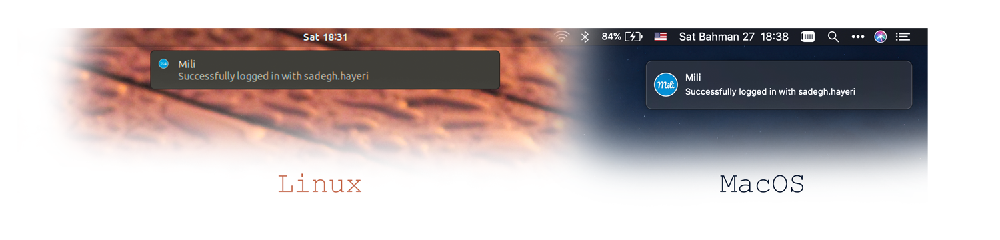

<p align="center">
  
</p>

<h1 align="center">Mili</h1>

<p align="center">
  <strong>Automatic hotspot login for MikroTik captive portals</strong>
</p>

<p align="center">
  
  
</p>

---

## Overview

Mili is an open-source tool that automatically logs you into MikroTik captive portal pages every time you connect to a WiFi network — no more opening a browser just to hit "Login".

<p align="center">
  
</p>

## Features

- **Auto-detect** MikroTik captive portals on every WiFi connect
- **Multiple credentials** — store as many username/password pairs as you like
- **Weighted random selection** — control how often each credential is used via a `share` value
- **Desktop notifications** on success or failure
- **macOS** (Intel & Apple Silicon) and **Linux** support

## Requirements

| Platform | Dependencies |
|----------|-------------|
| macOS | Homebrew (auto-installed), `jq`, `terminal-notifier` |
| Linux | `curl`, `jq`, `notify-send` |

## Installation

```bash
git clone https://github.com/SadeghHayeri/Mili.git
cd Mili/scripts
./install.sh

mili config
```

The installer will:
1. Install required dependencies
2. Copy Mili scripts to `~/.mili/bin/`
3. Register a system service that triggers on WiFi changes
4. Add `mili` to your PATH with shell auto-completion

### macOS: Disable captive portal popup (optional)

By default, macOS opens a mini-browser when it detects a captive portal. You can disable this so Mili handles logins silently. **Note: this requires temporarily disabling SIP — re-enable it immediately after.**

1. Reboot and hold **Command-R** until the Apple logo appears (Recovery Mode)
2. Open **Utilities > Terminal**
3. Run: `csrutil disable`
4. Reboot normally
5. Go to **Finder > Go > Go To Folder** → `/System/Library/CoreServices`
6. Rename `Captive Network Assistant` to something else (e.g. `Captive Network Assistant Disabled`)
7. Reboot into Recovery Mode again and run: `csrutil enable`

## Usage

| Command | Description |
|---------|-------------|
| `mili` | Check for captive portal and auto-login |
| `mili login` | Force a login attempt |
| `mili login <username>` | Login with a specific saved user |
| `mili status` | Show current login status |
| `mili logout` | Logout from the portal |
| `mili config` | Add or update credentials |

## Configuration

Credentials are stored in `~/.mili/config.json`. Run `mili config` to set them interactively, or edit the file directly:

```json
{
  "base_url": "http://your-mikrotik-url",
  "login_information": [
    {
      "username": "user1",
      "password": "pass1",
      "share": 5
    },
    {
      "username": "user2",
      "password": "pass2",
      "share": 1
    }
  ]
}
```

The `share` value is a weight — in the example above, `user1` is selected roughly 5× more often than `user2`.

## How It Works

1. On WiFi connect, Mili checks `captive.apple.com` for a captive portal response
2. If a MikroTik portal is detected, it picks a random credential based on share weights
3. If the random login fails, it tries all credentials in order
4. A desktop notification reports the outcome

## License

[MIT](LICENSE) — made with ♥ by [Sadegh Hayeri](https://github.com/SadeghHayeri)
